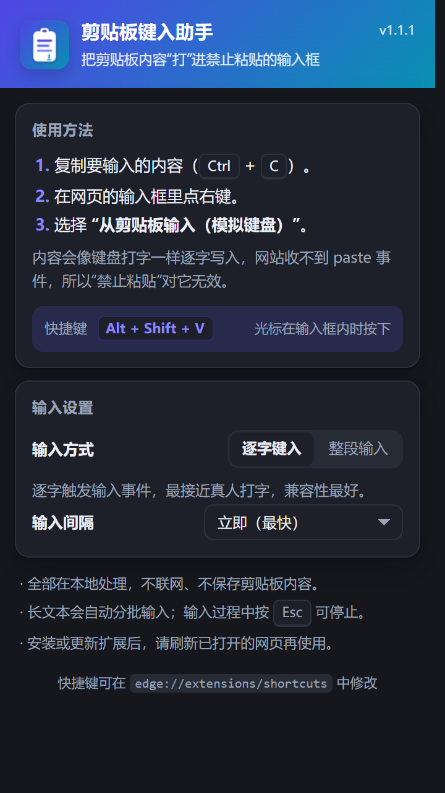
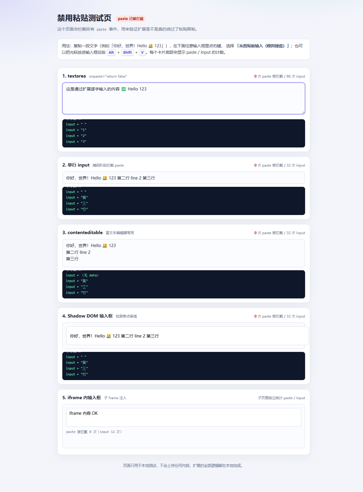

# 剪贴板键入助手 / Clipboard Typing Assistant

一个用于 Microsoft Edge（Chromium 内核）的浏览器扩展：在输入框右键选择 **「从剪贴板输入（模拟键盘）」**，把剪贴板内容以模拟键盘打字的方式填进去，绕过网站对粘贴（`Ctrl+V` / `paste` 事件）的限制。

适用于长表单、培训系统、政务与银行表单、论坛和后台编辑器等禁止粘贴的输入框。界面支持**简体中文（默认）**和 **English**，会跟随浏览器 UI 语言。



## 功能

- **右键菜单**：在任意可编辑输入框（`textarea`、`input`、`contenteditable`）里右键，选择「从剪贴板输入（模拟键盘）」。
- **不触发 paste**：扩展完全不派发 `paste` 事件，网站基于 `onpaste`、`paste` 监听、`clipboardData` 的拦截全部失效。
- **原生输入事件**：逐字调用浏览器的 `insertText` 编辑命令，页面收到的是浏览器生成的 `beforeinput` / `input` 事件（`isTrusted` 为 `true`），和真实打字走同一条表单更新路径。
- **兼容受控组件**：`insertText` 没有生效时，回退到原生 `value` setter + `input` 事件，适配 React / Vue 的受控输入框。
- **多场景支持**：普通输入框、富文本 `contenteditable`、开放 Shadow DOM、iframe 子页面。
- **快捷键**：默认 `Alt+Shift+V`，光标在输入框内时按下即可。
- **可调输入方式**：逐字键入 / 整段输入；输入间隔 0–120ms；长文本自动分批，避免页面卡死。
- **中英双语**：扩展名称、右键菜单、设置面板和页面提示条都跟随浏览器 UI 语言。
- **本地处理**：不联网、不上报、不保存剪贴板内容。

## 界面语言

- `manifest.json` 使用 `"default_locale": "zh_CN"`，默认中文。
- 语言文件在 `extension/_locales/zh_CN/` 和 `extension/_locales/en/`。
- 中文环境显示「剪贴板键入助手」，英文环境显示「Clipboard Typing Assistant」。
- 商店 listing 的中文语言在 Edge 合作伙伴中心「Manage languages」中添加。

## 安装（Edge）

1. 打开 `edge://extensions`。
2. 打开左下角的「开发人员模式」。
3. 点击「加载解压缩的扩展」，选择本项目里的 **`extension`** 文件夹（目录里应有 `manifest.json`）。
4. 建议点击工具栏的拼图图标，把「剪贴板键入助手」固定到工具栏。
5. 刷新已经打开的网页（安装前打开的页面不会自动注入内容脚本）。

> 如果 Edge 提示“是否允许来自其他商店的扩展”，选择允许即可。商店版本上传的是打包好的 zip，本地开发直接加载 `extension` 目录。

## 使用

1. 正常复制要输入的内容（`Ctrl+C`）。
2. 在网页的输入框里点右键，选择「从剪贴板输入（模拟键盘）」。
3. 内容会按设置逐字写入；输入过程中按 `Esc` 可以停止。
4. 也可以把光标放进输入框，按 `Alt+Shift+V`。

快捷键可在 `edge://extensions/shortcuts` 中修改。



上图是项目自带的禁用粘贴测试页：页面会拦截所有 `paste` 事件；扩展输入后，各输入框的 paste 计数仍然为 0，input 计数正常增长。

## 设置

点击工具栏图标打开设置面板：

- **输入方式**
  - **逐字键入**（默认）：每个字符调用一次 `insertText`，最接近真人打字，兼容性最好；超过 3000 字时自动按 80 字一批输入。
  - **整段输入**：一次性写入整段文本，速度最快。
- **输入间隔**：逐字模式下每个字符之间的等待时间，默认「立即」。

## 为什么能绕过“禁止粘贴”

网站常见的禁用粘贴方式：

- HTML：`onpaste="return false"`
- JS：`addEventListener('paste', e => e.preventDefault())`
- 监听 `paste` 读取 `clipboardData`，发现是粘贴就清空输入框
- 校验 `event.isTrusted`

本扩展**完全不触发 `paste` 事件**，所以以上拦截都不会发生。输入时使用的是浏览器内置的编辑命令：

```js
document.execCommand('insertText', false, '字');
```

浏览器会像处理真实键盘输入一样，派发 `beforeinput` / `input` 事件并更新表单状态。扩展按字符或批次循环调用，就得到了“模拟键盘逐字输入”的效果。

对 React / Vue 等受控组件，如果 `insertText` 没有生效，会改用原型上的原生 `value` setter 写入并派发 `input` 事件，绕过框架对 `value` 的劫持。

## 权限说明

| 权限 | 用途 |
| --- | --- |
| `contextMenus` | 添加右键菜单项 |
| `clipboardRead` | 读取剪贴板文本 |
| `offscreen` | MV3 Service Worker 没有 DOM，用不可见的 offscreen 页面读取剪贴板作为兜底 |
| `storage` | 保存输入方式、输入间隔设置 |
| `scripting` | 页面在扩展安装前已打开时，动态补注入内容脚本 |
| `host_permissions: <all_urls>` | 在所有网站的输入框上工作（包括 iframe） |

扩展没有任何网络请求，也不请求与网络相关的权限。

## 本地测试

项目自带一个会拦截所有 `paste` 事件的测试页：

```bash
node test/serve.mjs
# 浏览器打开 http://127.0.0.1:8123/
```

测试页包含 textarea、单行 input、contenteditable、Shadow DOM 输入框和 iframe 输入框，并实时统计 paste / input 事件次数。`test/paste-blocked-en.html` 是英文版表单，用于英文商店截图。

端到端测试（需要安装 Edge，默认路径 `C:\Program Files (x86)\Microsoft\Edge\Application\msedge.exe`）：

```bash
node test/serve.mjs        # 终端 1

# 终端 2：中文 UI（默认）
$env:EDGE_LANG='zh-CN'; node tools/e2e-edge.mjs

# 终端 2：英文 UI
$env:EDGE_LANG='en-US'; node tools/e2e-edge.mjs
```

`tools/e2e-edge.mjs` 会用无头 Edge 加载扩展，通过 CDP 自动验证 17 项：中文/英文 UI 与菜单标题、右键菜单注册、textarea / input / contenteditable / Shadow DOM / iframe 输入、paste 事件为 0、本地化提示条、剪贴板读取、快捷键注册、Popup 设置页等。截图输出到 `tools/out/`。

> 如果 Edge 不在默认路径，修改 `tools/e2e-edge.mjs` 里的 `EDGE` 常量。

## 商店图片

`store/` 下已经生成中英文两套素材：

- `logo-300.png`：扩展 logo（300×300）
- `screenshot-zh-1.png`、`screenshot-zh-2.png`、`screenshot-en-1.png`、`screenshot-en-2.png`：1280×800
- `small-promo-zh-440x280.png`、`small-promo-en-440x280.png`
- `large-promo-zh-1400x560.png`、`large-promo-en-1400x560.png`

修改界面或文案后运行 `python tools/make_store_assets.py` 重新生成。

## 已知限制

- **Canvas 类编辑器**（Google Docs、部分在线 Office、远程桌面网页客户端）：它们不依赖 DOM 输入框，本扩展无法输入。这类场景需要借助 `chrome.debugger`（会显示“正在调试”横幅）或系统级键盘模拟。
- 页面完全禁用右键菜单时，右键项不会弹出，请使用 `Alt+Shift+V`。
- 关闭的 Shadow DOM（closed shadow root）无法定位内部输入框。
- 扩展重新加载或更新后，已经打开的页面需要刷新才能使用（后台会尝试补注入，但旧页面的扩展上下文可能已失效）。
- 逐字模式可能产生多个撤销步骤；需要整段撤销时请使用「整段输入」。
- 网站自己的输入格式化（自动加空格、过滤字符等）仍会生效，最终内容可能和剪贴板略有差异。
- 输入框的 `maxlength` 仍会生效，超出部分会被截断。
- PDF 阅读器、`edge://` 页面、Edge 加载项商店等受限页面无法注入内容脚本。
- 某些网站会检测输入速度或行为，本扩展不保证通过这类风控。

## 文件结构

```
extension/            可直接“加载解压缩的扩展”的目录
  manifest.json       default_locale: zh_CN，名称/描述使用 __MSG__
  _locales/
    zh_CN/messages.json
    en/messages.json
  background.js       Service Worker：右键菜单、快捷键、剪贴板兜底
  content.js          输入核心：目标定位、逐字/整段写入、本地化提示条
  offscreen.html/js   读取剪贴板的不可见页面
  popup.html/css/js   工具栏设置面板（中英双语）
  icons/              图标
test/
  paste-blocked.html    中文禁用粘贴测试页
  paste-blocked-en.html 英文禁用粘贴表单（商店截图用）
  frame.html            iframe 子页面
  serve.mjs             本地静态服务器
tools/
  make_icons.py         生成图标
  make_store_assets.py  生成中英文商店截图/宣传图
  e2e-edge.mjs          Edge + CDP 端到端测试
store/                  中英文商店图片（Edge 合作伙伴中心上传）
docs/                   截图
release/                打包好的 zip
```

## 开发说明

- 无需构建，纯原生 JS + Manifest V3。
- 修改 `extension/` 后，在 `edge://extensions` 点击扩展卡片上的“重新加载”，再刷新网页。
- 图标修改后运行：`python tools/make_icons.py`（需要 Pillow）。
- 扩展使用 `document.execCommand('insertText')`。该 API 已被标记为废弃，但 Chromium 仍完整支持；这是目前不申请 `debugger` 权限就能产生原生输入事件的最佳方案。

## 隐私

扩展只做三件事：读取剪贴板、往当前页面输入、保存两个本地设置。没有网络请求、没有统计、没有日志上传。剪贴板内容只存在于内存中，输入完成后即释放。

## 许可

MIT
